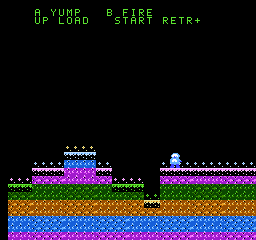
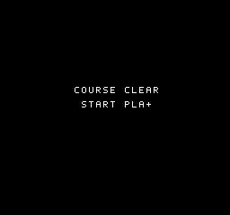
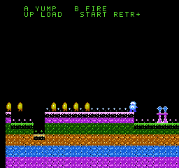
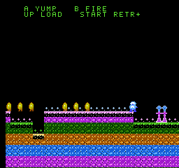
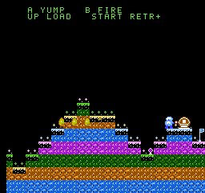
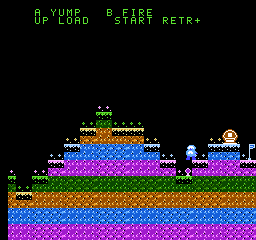

# 352402 基板の実機試験

[書き込みと照合](#書き込みと照合)を行ったあと、日本版 NTSC ファミコンで試験する。比較には `build/vrc7a-test-512k-prototype.nes` を Mesen で開く。Mesen は NTSC、1P に NES コントローラー、スプライト制限ありに設定する。

## 交換 ROM と U1 の確認

352402 の U1 には Sharp LH5341（512 KiB、DIP-32）が載っている。27C040 系を載せて動作した報告があるため、初回試験の候補を **AT27C040-70PU**（512 KiB、PDIP-32、ピン列間隔15.24 mm、読み出し時5 V ±10%、70 ns、ワンタイム書き込み）とする。使用する基板の U1 の配線と、この型番での動作は未確認。[基板写真と部品表](https://nescartdb.com/profile/view/3951/lagrange-point) · [27C040 系の交換報告](https://forums.nesdev.org/viewtopic.php?p=143260) · [AT27C040 データシート §2、§6、§8、§9.2](https://www.microchip.com/content/dam/mchp/documents/OTH/ProductDocuments/DataSheets/doc0189.pdf)

以下は AT27C040 の端子に合わせた U1 側の確認箇所。カートリッジを本体から抜き、交換 ROM を載せる前に配線を追う。端子番号は部品面から見た向きで数える。変換基板を使う場合は、U1 のパッドから交換 ROM の端子までを照合する。

| AT27C040 の端子 | 352402 側で確認する接続 |
| --- | --- |
| 1 VPP | パッドの接続先を確認する。読み出し時は VPP を32番の VCC につないで使える。パッドが別の信号につながっている場合は、変換基板でパッドから切り離して ROM 側の VPP を VCC につなぐ。 |
| 16 GND、32 VCC | GND と +5 V の電源系統。ROM を載せる前に電源と GND の短絡がないことも確認する。 |
| 22 /CE、24 /OE | 22番は VRC7 の44番（PRG ROM /CE）の系統。24番は読み出し時に Low になることを配線で確認する。両方が Low のとき ROM がデータバスを駆動する。 |
| 4–12、23、25–27 | AT27C040 の端子表に従い、CPU A0–A12 に1本ずつ対応することを確認する。 |
| 28、29、3、2、30、31 | PRG A13–A18 の順。VRC7 の20、21、22、23、25、26番との対応を確認する。 |
| 13–15、17–21 | CPU D0–D7 の順。 |

ソケットを使う場合は、ROM を挿した高さでケースが閉じるかも確認する。[AT27C040 の読み出し条件と端子表](https://www.microchip.com/content/dam/mchp/documents/OTH/ProductDocuments/DataSheets/doc0189.pdf) · [VRC7 の端子表](https://www.nesdev.org/wiki/VRC7_pinout)

書き換え用に SST39SF040 を選ぶ場合は専用の端子変換が必要。PDIP 版では A18 が1番、/WE が31番にある。U1 が上表の配線なら U1 の31番を Flash の A18 に回し、Flash の /WE は VCC に固定する。U1 の1番は Flash の1番から切り離す。[SST39SF040 データシート 図2-1](https://ww1.microchip.com/downloads/aemDocuments/documents/MPD/ProductDocuments/DataSheets/SST39SF010A-SST39SF020A-SST39SF040-Data-Sheet-DS20005022.pdf)

## 書き込みと照合

試験用 ZIP は展開し、PowerShell で展開先のルートを開く。同梱の `SHA256SUMS.txt` で PRG と NES イメージのハッシュを確認できる。

```powershell
Get-FileHash -Algorithm SHA256 build/vrc7a-test-512k-prototype.prg, build/vrc7a-test-512k-prototype.nes
```

T48 の対応表には `AT27C040 @DIP32` がある。Xgpro で同じ項目を選び、ガイドが示す向きで交換 ROM を ZIF ソケットに挿す。ブランクチェックの後、`build/vrc7a-test-512k-prototype.prg`（524,288バイト）をオフセット0から書き込む。取り付け前に全域を `build/readback.bin` などの別ファイルへ読み戻す。[T48 の対応表](https://docs.rs-online.com/f666/0900766b814b5d4b.pdf)

```powershell
./tools/verify-prg-readback.ps1 -Readback build/readback.bin
```

照合が通ったら、表示された SHA-256 を試験記録に残す。別の場所に保存した書き込み元 PRG を使う場合は `-Prg` でパスを指定する。音声収録を行う場合は、先に `build/audio` を作っておく。

## 起動と音

1. 電源を入れ、音源画面が出て、FM が6声を順に鳴らしてから伴奏に移ることを確認する。音源画面まで進めば、全64バンクの先頭バイトと WRAM の起動時検査が通っている。`BANK OR RAM ERROR` や無表示の場合はその状態を記録する。固定バンクからリセット処理を実行できない場合はエラー画面も出ない。
2. 1P の左で FM 単独、右で APU 単独、下で同時発音を聞く。同時発音では片方が埋もれないか、音割れや音切れがないかを聞く。
3. 上で消音、下で同時発音に戻し、リセットして最初から6声が順に鳴ることを確認する。音量を比較するときは試験中の録音レベルを固定する。

### 録音の比較

Mesen と実機の音源画面で、左（FM）、右（APU）、下（同時発音）、上（消音）をそれぞれ録音する。切り替え直後の音が落ち着いてから、各モードを約6秒ずつ切り出し、16ビット PCM WAV で保存する。同じ環境内の4区間は入力ゲインをそろえ、自動ゲイン・ノーマライズを無効にする。

たとえば実機側の4ファイルを `build/audio` に保存した場合は、リポジトリのルートから次を実行する。Mesen 側も同じコマンドで比較する。

```powershell
python tools/measure-audio.py build/audio/fm.wav build/audio/apu.wav build/audio/mix.wav build/audio/mute.wav
```

チャンネルごとの RMS（直流成分を除いた実効値）、ピーク、最大値または最小値に達したサンプル数が出る。各環境内で同じチャンネルの FM 単独と APU 単独の RMS 差を記録し、実機と Mesen の差を比べる。同時発音で上限に達するサンプルが出た場合は録音ゲインと波形を確認する。音割れ、音切れ、射撃音の聞こえ方は試聴でも確認する。

#### 512 KiB版の Mesen 測定値

Mesen 2.1.1（`137ae7c`）の NTSC、マスター音量・NES 各音源の音量100%、パン中央、EQ・リバーブ・クロスフィード無効で収録した。ビルドは全 PRG バンクの起動検査を含むコミット `558dcbe`、生 PRG の SHA-256 は `534D1FFC51B757E855C0063C7583D72115C9D7A125406A2056001D73BE2B4B71`。内蔵の Sound Recorder が出力した48 kHz・16ビット PCM の各6秒間を測定し、左右チャンネルのサンプルが一致することも確認した。

| モード | RMS (dBFS) | ピーク (dBFS) | 上限または下限に達したサンプル数／チャンネル |
| --- | ---: | ---: | ---: |
| FM 単独 | −29.83 | −18.24 | 0 |
| APU 単独 | −35.53 | −32.38 | 0 |
| 同時発音 | −28.67 | −17.12 | 0 |
| 消音 | −∞ | −∞ | 0 |

このビルドでは FM 単独の RMS が APU 単独より 5.70 dB 高かった。読み戻した PRG の SHA-256 が上記と一致すれば、この表を実機との比較に使える。別のビルドを書き込んだ場合は、対応する `.nes` で再収録する。

再収録する場合は、1P を NES コントローラーに設定し、音源画面で **Tools → Sound Recorder → Record** を選ぶ。**Debug → Script Window** で [audio-record-modes.lua](../tools/mesen/audio-record-modes.lua) を開き、**F5** で実行する。約2秒後に FM 単独に切り替わり、その後約10秒おきに APU 単独、同時発音、消音に切り替わる。消音に切り替わってから8秒以上待ち、**Sound Recorder → Stop** で保存する。波形で切り替え位置を確かめ、各切り替えから約2秒空けて6秒の区間を切り出す。今回の測定区間は録音開始から10〜16秒、20〜26秒、30〜36秒、40〜46秒だった。収録後は Script Window を閉じると1Pの手動操作に戻る。

## 二軸コース

1. 音源画面から **A → START**。操作できる状態になったら **上** で負荷試験用の印を出す。右で進み、上り段で足が止まったら右を押したまま **A**。最初の敵には、同じ高さの地面で敵までプレイヤー約1〜2体分の距離があるうちに **B** で撃つ。地形が縦・横に動いても上端の HUD が動かず、地形に欠けが出ないことを確認する。
2. **通常クリア**。ひし形の標識を過ぎたら窯と同じ高さの段へ登り、そのまま右へ進む。段で止まったら右＋A。窯の色が明るくなっても立ち止まらず、右端の旗に着地する。`COURSE CLEAR` が出たら **START** で最初からやり直す。
3. **被弾後のクリア**。上で印を出し、同じルートを通る。今度は窯と同じ高さの段に上がった直後、窯の左で右を離す。段の左端から半タイル程度の範囲が目安。B を押さずに着地して待ち、左へ飛ぶ火花が見えてから被弾することを確認する。段の下で待つと火花が頭上を通る。
4. 被弾後に **START**。コースの最初ではなく標識のすぐ右に戻り、被弾前の火花が消えていて、HUD と地形がすぐ表示されることを確認する。上で印を出し、右＋A で窯の段を越えて旗に着地する。クリア後の **START** で最初へ戻る。

512 KiB版を Mesen のコントローラー入力で検証し、上り段でジャンプする通常クリアと、窯の段の左端付近で止まってから被弾・途中復帰し、クリアする経路を確認した。密集時は負荷試験用の印が入れ替わって見え、火花は被弾直前まで表示される。[コース全体の自動試験](../tools/mesen/course-clear-smoke.lua)

### 512 KiB版の Mesen 比較画像

音声測定と同じ `558dcbe` の PRG を Mesen 2.1.1 の NTSC、スプライト制限あり、フィルターなしで実行した。コース全体の自動試験が確認したフレームを256×240の画像にした。実機映像では、対応する場面の HUD、地形の形、キャラクターと火花の位置を見比べる。印の並びは撮影するフレームで変わる。

| 開始位置 | クリア |
| --- | --- |
|  |  |

| 斜めスクロールの1フレーム前 | 行と列を同時更新したフレーム |
| --- | --- |
|  |  |

| 火花と負荷試験用の印 | 被弾からの途中復帰 |
| --- | --- |
|  |  |

## 試験記録

- 日付、ビルドのコミット、読み戻し照合で表示された SHA-256
- ファミコン本体と352402基板の刻印、交換ROM・変換基板・ライターの型番、読み戻し結果
- 音声と映像の接続、Mesen のバージョンと設定、録音・録画ファイルがあれば保存先

| 確認項目 | 実機の結果と差が出た場面 |
| --- | --- |
| 電源投入・リセット時のバンク検査、音源画面、FM の6声 | |
| FM／APU の単独・同時発音、消音と再開、FM と APU の RMS 差、同時発音のピークと音割れ | |
| 固定 HUD と地形の縦・横の継ぎ目 | |
| 印を表示した状態での射撃音と窯の火花 | |
| 旗でクリアし、START で先頭に戻る | |
| 被弾後に標識の右へ戻り、同じコースをクリアする | |
